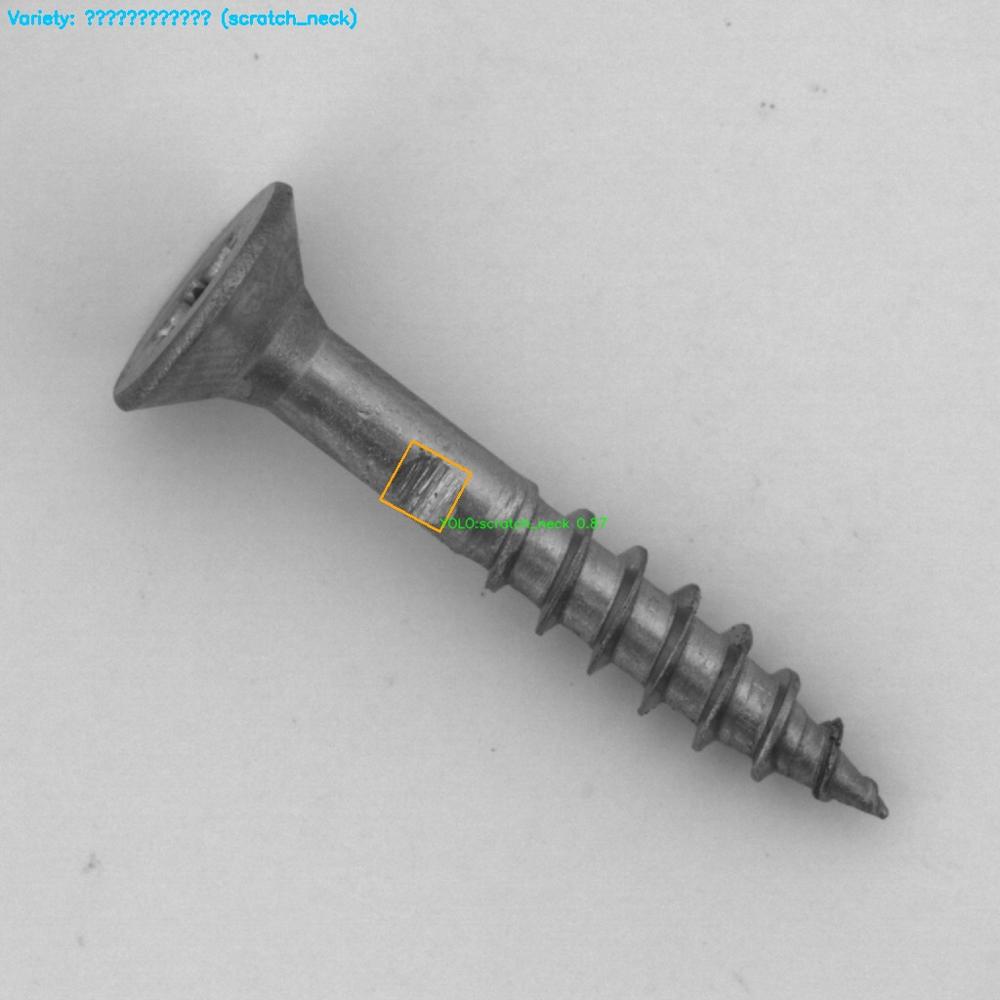
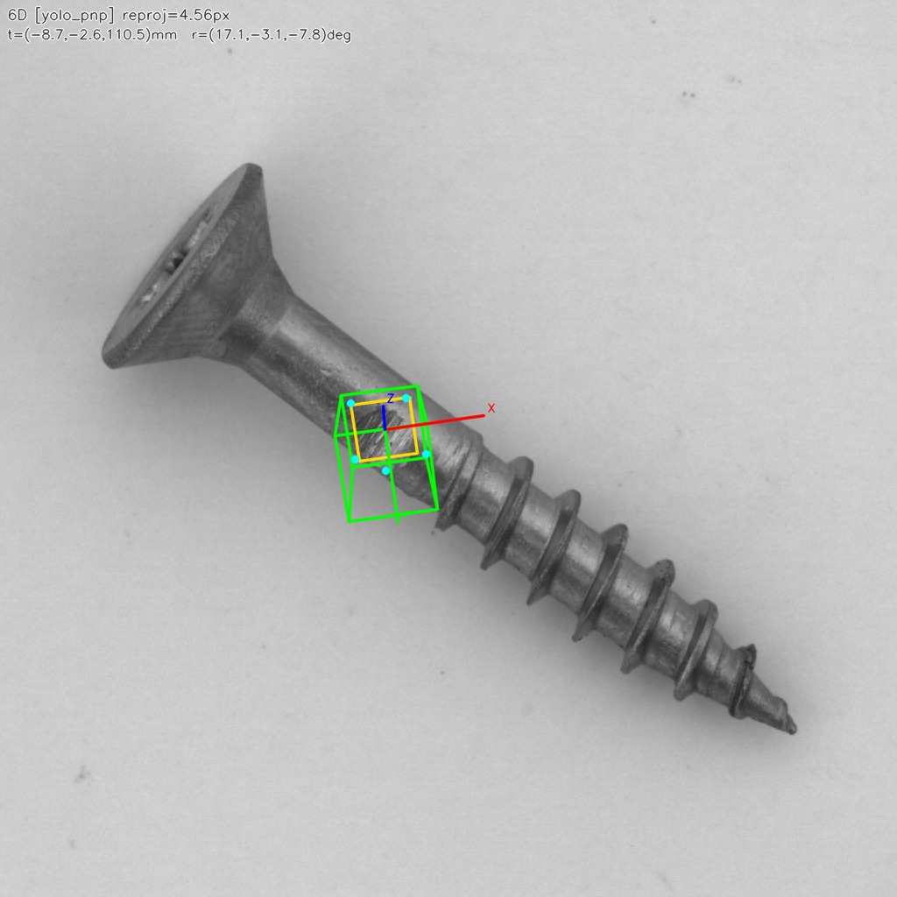

# ScrewInspect —— 螺丝缺陷智能质检与分拣系统

面向汽车零部件产线混线场景的 **螺丝外观缺陷质检** 系统。数据与类别对齐 Hugging Face 数据集 [shrish23/screw-dataset](https://huggingface.co/datasets/shrish23/screw-dataset)，流水线采用 **YOLOv8 粗筛 + VLM 精查 + 策略规则引擎** 的分层架构。

## 缺陷类别

| class_id | 中文说明 |
|----------|----------|
| `good` | 良好 |
| `manipulated_front` | 正面被篡改 / 正面被动手脚 |
| `scratch_head` | 头部划痕 |
| `scratch_neck` | 颈部划痕 |
| `thread_side` | 侧面螺纹 / 侧面线纹缺陷 |
| `thread_top` | 顶部螺纹 / 顶部线纹缺陷 |

## 质检流水线

```
螺丝图像上传
    → YOLOv8 粗筛（双阈值：0.15 召回 / 0.5 触发精查）
        → 明显良品：毫秒级放行（跳过 VLM）
        → 可疑件：VLM 精查（豆包多模态，超时 3s 回退 YOLO）
    → FAISS 策略规则匹配
    → 分拣决策：pass（良品）/ block（不合格）/ review（人工复检）
    → 6D 位姿估计（YOLOv8-Pose+solvePnP / 轮廓回退 → 手眼变换至机器人系）
```

## 快速开始

### 环境要求

- Python 3.10+
- Node.js 18+
- 豆包 Ark API Key（VLM 精查）

### 1. 后端

```bash
cd backend
pip install -r requirements.txt
cp .env.example .env
# 编辑 .env 填入 ARK_API_KEY、ARK_MODEL_ID

python seed_data.py
python -m uvicorn app.main:app --reload --port 8000
```

### 2. 下载训练数据集（可选）

```bash
cd backend
python scripts/download_screw_dataset.py
# 输出目录默认: ../data/screw-dataset
```

### 3. YOLO 粗筛权重（可选）

使用 `data/screw-dataset` 训练 YOLOv8 检测/分割模型后，在 `.env` 中配置：

```env
YOLO_MODEL_PATH=models/screw_yolov8.pt
YOLO_RECALL_THRESHOLD=0.15
YOLO_VLM_TRIGGER_THRESHOLD=0.5
```

未配置时将 **跳过粗筛快速放行**，所有图片进入 VLM 精查（便于开发调试）。

### 5. 6D 位姿（分拣/机械臂）

| 模式 | 说明 |
|------|------|
| `auto`（默认） | 若配置 `YOLO_POSE_MODEL_PATH` 则 Path A，否则 Path B 轮廓 solvePnP |
| `yolo_pnp` | 仅 YOLOv8-Pose + 3D 模型关键点 + solvePnP |
| `contour_pnp` | 开发/仿真：Otsu 轮廓 + minAreaRect 四点 |

相机内参默认 `backend/app/assets/default_camera_intrinsics.json`，手眼矩阵默认单位阵 `hand_eye_identity.json`。产线请替换为标定结果。

接口：`GET /api/meta/pose-config`；任务字段 `pose_result`（JSON）含 `camera_frame` / `robot_frame` 平移与欧拉角。

### 4. 前端

```bash
cd frontend
npm install
npm run dev
```

访问 `http://localhost:5173`，在 **质检提交** 页上传螺丝图片进行单件或批量检测。

## 项目结构

```
Defect Detection/
├── backend/
│   ├── app/
│   │   ├── defect_types.py          # 六类缺陷常量
│   │   ├── services/
│   │   │   ├── coarse_screen_service.py  # YOLOv8 粗筛
│   │   │   ├── pose_service.py           # 6D 位姿（YOLO-Pose / 轮廓 PnP）
│   │   │   ├── hand_eye.py               # 手眼标定变换
│   │   │   ├── doubao_service.py         # VLM 精查
│   │   │   ├── rule_engine.py            # 分拣决策
│   │   │   └── task_service.py           # 流水线编排
│   │   ├── assets/                       # 相机内参、手眼矩阵、螺丝 3D 关键点
│   │   └── routers/meta.py          # defect-classes / pose-config
│   ├── scripts/download_screw_dataset.py
│   └── seed_data.py                 # 六类缺陷分拣策略
└── frontend/                        # React 质检控制台
```

## API

| 接口 | 说明 |
|------|------|
| `POST /api/tasks/` | 上传螺丝图片创建质检任务 |
| `POST /api/batches/` | 批量质检 |
| `GET /api/meta/defect-classes` | 缺陷类别与数据集信息 |
| `GET /api/dashboard/*` | 看板统计 |

## 技术栈

FastAPI · SQLAlchemy · 豆包 VLM · FAISS · React · Vite · Tailwind

## 检测预览

样例为颈部划痕 `scratch_neck/060`。

| VLM 精查 | 6D 位姿 |
| --- | --- |
|  |  |
